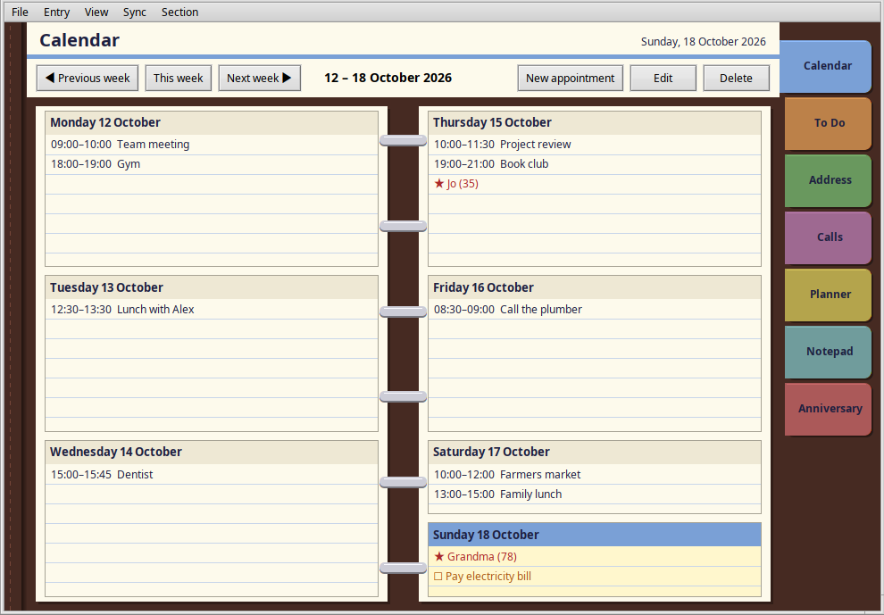
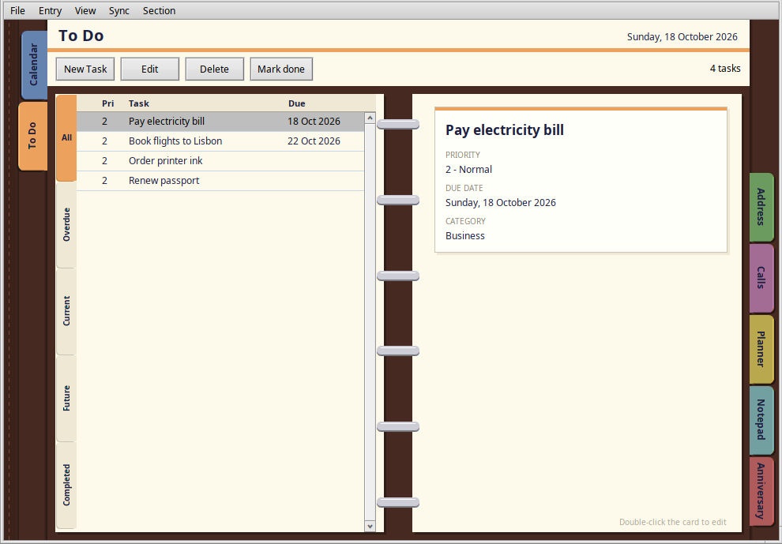
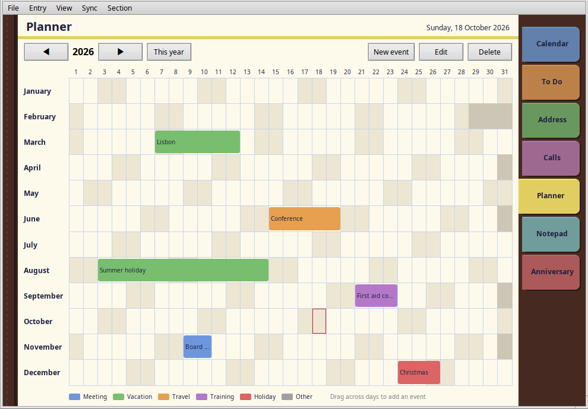

# Ringbinder

A tabbed personal organizer for Haiku, Renku OS and VitruvianOS (a BeOS-like OS based on Linux), modelled on the classic late-90s
desktop organizers: a leather ring binder with coloured section dividers,
two-page spreads for each section, a week-at-a-glance diary, and everything
saved automatically.

Like a real binder, the tabs of the sections you have turned past move to
the left-hand edge, and the ones still to come stay on the right.

Native C++ against the Haiku API (Interface Kit + layout API). Optional
two-way sync with Google Calendar and Google Contacts uses libcurl.







## Install

**Haiku and Renku OS.** Download `ringbinder-1.1.0-1-x86_64.hpkg` from the
[1.1.0 release](https://github.com/idumych/ringbinder/releases/tag/v1.1.0)
and install it from a Terminal:

```sh
pkgman install ./ringbinder-1.1.0-1-x86_64.hpkg
```

Ringbinder then appears under **Applications** in the Deskbar menu, and as
`ringbinder` in the Terminal. It needs Haiku R1/beta6 or later (it has been
tested on Renku OS) and libcurl, which pkgman installs if it's missing.

**VitruvianOS.** Download `ringbinder_1.1.1-1_amd64.deb` from the
[1.1.1 release](https://github.com/idumych/ringbinder/releases/tag/v1.1.1)
and install it from a Terminal:

```sh
sudo apt install ./ringbinder_1.1.1-1_amd64.deb
```

It appears in the Deskbar's Applications menu and as `ringbinder`. It is
built for VitruvianOS 0.6.x; apt pulls in libcurl if it's missing.

**Linux.** Download `Ringbinder-1.3.0-x86_64.AppImage` from the
[1.3.0 release](https://github.com/idumych/ringbinder/releases/tag/v1.3.0),
make it executable and run it:

```sh
chmod +x Ringbinder-1.3.0-x86_64.AppImage
./Ringbinder-1.3.0-x86_64.AppImage
```

It needs an x86-64 distribution with glibc 2.43 or newer (Ubuntu 26.04, or a
current rolling distribution such as Arch). It uses the
[Cosmoe](https://github.com/haydentech/cosmoe) library, which it bundles and
which is only built for that baseline. Cosmoe supports X11 and Wayland; so far
Ringbinder has only been tested on X11.
Your data is kept in `~/.config/cosmoe/Ringbinder/`. Use the web version
instead if you'd rather not run a native app.

## Sections

| Tab | What it does |
|-----|--------------|
| **Calendar** | Two-page week spread (Mon–Wed left, Thu–Sun right, binder rings in the middle). Double-click an empty day to add an appointment, double-click an entry to edit it. Anniversaries (★) and To Do items due that day (☐) appear automatically. |
| **To Do** | Tasks on the left-hand page, the selected task's card on the right. Tabs down the page edge show All, Overdue, Current (due within a week, or no due date), Future and Completed. Completed tasks drop to the bottom, struck through. |
| **Address** | Contacts on the left-hand page with A–Z thumb tabs down its edge; the selected contact's card on the right. |
| **Calls** | Call log / call-back list (Outgoing, Incoming, Missed, Call back) on the left, the selected call on the right, with a completed flag. |
| **Planner** | A single full-width year page, punched for the rings. The columns are weekdays, as on a paper year planner, so weekends form vertical stripes; the 1st of each month has a red corner and today is outlined in red. **Drag across days** to block out a vacation or trip. |
| **Notepad** | Contents on the left-hand page, the open page on the right; edits save when you change page, switch tab or quit. |
| **Anniversary** | Half a year per spread, three months to a page, with each person's age and how soon the date comes up. Ages and anniversaries also appear on the Calendar. |

## Keyboard

The shortcut key is your Haiku command key (Alt or Ctrl, per the Keymap preferences).

| Keys | Action |
|------|--------|
| Cmd+1 … Cmd+7 | Turn to a section |
| Cmd+N / Cmd+E / Cmd+D | New / edit / delete entry |
| Cmd+K | Mark task or call done / not done |
| Cmd+← / Cmd+→ / Cmd+T | Previous / next week or year, back to today |
| Cmd+S | Save now (it also saves on every change) |
| Cmd+Y | Sync with Google now |

## Google Calendar and Contacts sync

**Sync → Google sync settings…** connects Ringbinder to a Google account:

- **Calendar tab ↔ Google Calendar** (your primary calendar, or any calendar ID)
- **Address tab ↔ Google Contacts**

Sync is two-way. New entries, edits and deletions go in both directions,
automatically (every 15 minutes to every 4 hours) or when you press **Cmd+Y**.
It runs in the background; a notification tells you what changed.

### One-time setup: your own Google OAuth client

Ringbinder talks to Google directly with a client ID that you own, so no
third-party server is involved and there is no shared key to be revoked.

1. Go to <https://console.cloud.google.com/> and create a project (any name).
2. **APIs & Services → Library**: enable **Google Calendar API** and **People API**.
3. **APIs & Services → OAuth consent screen**: choose *External*, fill in the
   app name and your e-mail, and add your Google address under *Test users*.
4. **APIs & Services → Credentials → Create credentials → OAuth client ID**,
   application type **Desktop app**.
5. Copy the **Client ID** and **Client secret** into Ringbinder's Google sync
   settings and click **Connect…**. Your browser opens; sign in and allow
   access. Ringbinder catches Google's reply on a local port and the first
   sync starts.

> **Weekly sign-ins?** While the consent screen's publishing status is
> *Testing*, Google expires the sign-in after 7 days. To avoid reconnecting
> every week, set the publishing status to **In production**. Google will
> then show an "unverified app" warning during sign-in; it is your own app,
> so choose *Advanced → Go to Ringbinder*.

### How conflicts and deletions are handled

- If an entry changed on both sides since the last sync, **the newer edit wins**.
- Only fields that actually changed are sent to Google, so things Ringbinder
  doesn't show (extra phone numbers, websites, attendees, reminders, colours)
  are left intact.
- On the first sync, entries that already exist on both sides (same name and
  e-mail/phone for contacts; same title, date and start time for appointments)
  are linked rather than duplicated, and empty fields are filled in from
  either side.
- Deleting a synced entry deletes it in Google too, and vice versa. If you
  edited an entry in Ringbinder that was meanwhile deleted in Google, your
  edited copy is kept and re-created in Google.
- **Disconnect** stops syncing but deletes nothing. Changing the Calendar ID
  unlinks appointments from the old calendar rather than deleting anything.

### Limits

- Calendar sync covers 6 months back to 18 months ahead.
- Repeating events appear as individual occurrences; editing one changes only
  that occurrence. Repeating events can't be created from Ringbinder.
- A multi-day all-day event appears on its first day.
- Google birthdays without a year aren't copied into the Birthday field.
- Only the first e-mail and address, one work and one mobile number are shown
  and edited; any others are kept in Google untouched.
- To Do, Calls, Planner, Notepad and Anniversary are not synced.
- Ringbinder never stores your Google password. It does store a sign-in token
  and the client secret in its settings file; remove access at any time at
  <https://myaccount.google.com/permissions>.

## Web version

`web/` is a port of Ringbinder that runs in any modern browser: plain
HTML, CSS and JavaScript with no build step and no dependencies. It has the
same seven sections, the same To Do and Address filtering, and the same
tab-migrating binder.

To try it, serve the folder (or just open `web/index.html`):

```sh
python3 -m http.server -d web 8000   # then visit http://localhost:8000
```

To publish it, copy the `web/` folder to any static host.

- Data is stored in the browser's `localStorage`, so it stays on that
  device. **Export…** saves the whole binder as a JSON file and **Import…**
  replaces the binder with one; use them to back up or move between browsers.
  The export is not the native app's `organizer.data` format.
- Keys: `1`–`7` turn to a section, `N` / `E` / `D` new / edit / delete,
  `K` done, `←` / `→` / `T` previous / next / today.
- Google Calendar and Contacts sync is not part of the web version.
- A self-hosted version with user login is planned, so a binder can live on
  your own server instead of in one browser.

## Building

Install the development tools if you haven't, plus libcurl's headers for Google
sync:

```sh
pkgman install haiku_devel makefile_engine curl_devel
```

Then in this folder:

```sh
make
```

The app is placed in `objects.x86_64-cc13-release/Ringbinder` (the folder
name depends on your architecture and compiler). `make hpkg` builds the
Haiku package instead. Without the makefile-engine:

```sh
g++ -O2 -std=c++11 -o Ringbinder *.cpp sync/*.cpp -lbe -lnetwork -lcurl
rc Ringbinder.rdef && xres -o Ringbinder Ringbinder.rsrc
mimeset -f Ringbinder
```

### Linux (AppImage)

`make` also builds on plain Linux against [Cosmoe](https://github.com/haydentech/cosmoe)
(the Haiku API as a library). `sh packaging/appimage/build-appimage.sh`
builds the AppImage: it downloads Cosmoe's prebuilt packages (built for
Ubuntu 26.04, so the result needs glibc 2.43 or newer), which is also what
GitHub Actions does in an Ubuntu 26.04 container. With `COSMOE_FROM_SOURCE=1`
it builds Cosmoe from source instead (about 20 minutes), which on Ubuntu 24.04
gives an AppImage for older distributions.

### VitruvianOS

On VitruvianOS the same `make` builds `./Ringbinder`, using the headers from
`pkg-config vos` (vos-dev) or `/system/develop/headers`, plus libcurl's
headers (`libcurl4-openssl-dev`). `make deb` builds the Debian package.

On another Linux you can still compile, link and package it, without a
VitruvianOS machine: `sh tools/vos-sdk/make-sdk.sh` builds a link-time SDK
from VitruvianOS's source (about four minutes), then

```sh
. .vos-sdk/sdk/env.sh && make deb
```

## Data

Everything is stored in one file, `~/config/settings/Ringbinder/organizer.data`
(a flattened `BMessage`). Saves are written to a temporary file and then
renamed over the old one, so a crash mid-save can't corrupt your binder. If
the file is ever unreadable it is set aside as `organizer.data.unreadable`
rather than overwritten.

## Source layout

| File | Purpose |
|------|---------|
| `App.cpp` | `BApplication`, loads the data store |
| `BinderWindow.*` | Main window, menus, routes commands to the visible page |
| `tools/vos-sdk/` | Builds the VitruvianOS link-time SDK on any Linux host |
| `packaging/` | `haiku/` (hpkg), `build-deb.sh` and `debian/` (VitruvianOS .deb), release notes |
| `TabStrip.*` | Section tabs on both edges, the leather spine, and the Planner's punched ring margin |
| `Spread.*` | An open two-page spread with the rings down the middle |
| `Section.*` | Base class for a binder page, page header |
| `RecordListSection.*` | Generic list spread with index tabs and a record card (To Do, Address, Calls) |
| `AnniversarySection.*` | Half-year anniversary spread |
| `SectionFactory.cpp` | Field and column definitions for the list pages |
| `CalendarSection.*` | Week spread view |
| `PlannerSection.*` | Year grid view |
| `NotepadSection.*` | Notepad |
| `EditWindow.*` | Generic record editor built from field descriptions |
| `DataStore.*` | Persistence |
| `DateUtil.*` | Calendar arithmetic |
| `GoogleSync.*` | Runs sign-in and sync on background threads, applies results |
| `GoogleSettingsWindow.*` | The Google sync settings window |
| `sync/SyncCore.*` | The two-way sync engine (plain C++, no Haiku dependencies) |
| `sync/GoogleAuth.*` | OAuth 2.0 sign-in: PKCE, local redirect listener, token refresh |
| `sync/Json.*`, `sync/Http.*`, `sync/CurlTransport.cpp` | JSON and HTTPS helpers |
| `sync/tests/` | Tests for the sync engine against a simulated Google; run `sync/tests/run_tests.sh` on any system with a C++ compiler |

Adding a field to a list section is a one-line change in `SectionFactory.cpp`.

## License

MIT.
